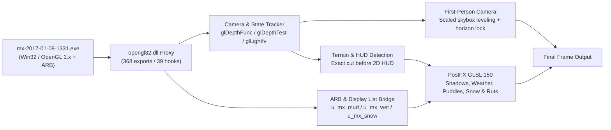

<div align="center">



<br />
<br />

-111827?style=for-the-badge&labelColor=e11d48)


<br />

<p>
  <a href="#english"></a>
  &nbsp;
  <a href="#espanol"></a>
</p>

<br />


<br />
<sub>Left: Stock MX Simulator 2017. Right: MXS-Remastered-Rodri with dynamic time of day, directional shadows, detailed dirt texture, and persistent tire ruts.</sub>

</div>

---

<a id="english"></a>

# English

<p align="center">
  <a href="#en-overview">Overview</a> &nbsp;&middot;&nbsp;
  <a href="#en-features">Features</a> &nbsp;&middot;&nbsp;
  <a href="#en-architecture">Architecture</a> &nbsp;&middot;&nbsp;
  <a href="#en-port">2017 Snapshot Fixes</a> &nbsp;&middot;&nbsp;
  <a href="#en-install">Installation</a> &nbsp;&middot;&nbsp;
  <a href="#en-controls">Controls</a> &nbsp;&middot;&nbsp;
  <a href="#en-integrity">Integrity</a> &nbsp;&middot;&nbsp;
  <a href="#en-credits">Credits</a> &nbsp;&middot;&nbsp;
  <a href="#espanol"><strong>Ver en Espanol</strong></a>
</p>

<a id="en-overview"></a>
## Overview

**MXS-Remastered-Rodri** is a **32-bit (`Win32`)** compatibility port of the open-source [Voaks/MXS-Remastered](https://github.com/Voaks/MXS-Remastered) project, re-engineered at the OpenGL call level to run natively on the classic **MX Simulator 2017 Snapshot (`mx-2017-01-08-1331.exe`)**.

While the upstream project targets modern 64-bit MX Simulator builds using OpenGL 3.x+ shader pipelines, this edition implements a full compatibility bridge between the 2017 engine (OpenGL 1.x fixed-function stack + `GL_ARB_shader_objects` + `Display Lists`) and the modern `GLSL 150` post-processing, weather, shadow-map, and dynamic first-person camera pipeline — without modifying any original game executable or `.saf` archive.

<a id="en-features"></a>
## Key Features

| Module | Stock MX Simulator 2017 | MXS-Remastered-Rodri |
| :--- | :--- | :--- |
| **Lighting & Sky** | Static track lighting | Dynamic time of day (`00:00` to `24:00`), real sun movement, god rays, bloom, and exposure grading |
| **Shadows** | No dynamic shadow maps | Real-time `2048x2048` shadow maps for bike, rider, and scenery, ambient occlusion (AO), and first-person torso shadow |
| **Dynamic Weather** | No ground weather effects | Rain with soaked dirt, reflective puddles, and wet bike/rider sheen; snow accumulation on terrain and tires |
| **Terrain & Wheels** | Flat surface without persistent marks | Fine dirt detail, persistent dual-wheel tire ruts, mud/snow tire buildup, and dynamic roost |
| **First-Person Camera** | Rigid stock camera | Horizon and pitch leveling (`HorizonLock` / `PitchLock`), inertial smoothing, dynamic neck response, and `HideOwnBody` |
| **Engine Sound Packs** | Stock 2017 soundtables | 5 bundled engine packs (`125 2T`, `250 2T`, `250F 4T`, `450F 4T`, and `450F 4T Clear`) toggleable in-game |
| **HUD & Menus** | Flat 2D quads under `glFrustum` | Exact pre-HUD detection (`GL_ALWAYS`), keeping HUD, menus, and loading screens sharp and undistorted |
| **Live Overlay** | Manual config file editing | In-game settings menu via <kbd>E</kbd>, 5 switchable presets, and live saving |

<a id="en-architecture"></a>
## Proxy Architecture

`opengl32.dll` acts as a transparent proxy in front of the system library (`SysWOW64\opengl32.dll`). It hooks only the required rendering boundaries of the 2017 pipeline and forwards all 368 remaining OpenGL exports directly with minimal overhead.



<a id="en-port"></a>
## 2017 Snapshot Compatibility Fixes

<details>
<summary><strong>View technical breakdown of all 2017 Snapshot adaptations (click to expand)</strong></summary>

<br />

1. **Native `Win32` (`x86`) build:** 32-bit indirect jump stubs (`368` exports) compatible with `mx-2017-01-08-1331.exe`.
2. **Deterministic terrain and HUD boundary detection (`glDepthFunc`):** the 2017 snapshot draws terrain with `GL_ALWAYS`, switches to `GL_LEQUAL` for 3D scenery/riders, and returns to `GL_ALWAYS` for HUD while keeping `glFrustum`. Tracking those transitions closes the terrain pass at the exact call and prevents HUD darkening or camera tilt.
3. **Menu and loading screen protection:** tracks `GL_DEPTH_TEST`, `glLightfv`, and active shader programs so settings menus and loading screens (`Loading decals.`) are never misclassified as 3D cameras.
4. **Scaled skybox leveling (`glScalef`):** decomposes uniform rotation matrices (`2886.75x`) on the 2017 skybox to eliminate diagonal horizon tears when `HorizonLock` is active.
5. **`float32` precision on large-coordinate tracks:** relative tolerance in `SameMat4` prevents losing the terrain mask (snow, puddles, and tire ruts) on tracks located beyond `2048` ft from the world origin.
6. **`GL_ARB_shader_objects` and `GL_EXT_framebuffer_object` compatibility:** isolates secondary offscreen FBO passes, saves/restores ARB program handles and `GL_DEPTH_FUNC` around `postfx`, and adds ARB fallbacks to `FlushShadowCasters`.
7. **2017 `GLSL 1.10` tire snow and wet sheen:** injects `u_mx_mud`, `u_mx_wet`, and `u_mx_snow` safely into the original 2017 bike/rider fragment shaders.
8. **`Display Lists` and 3rd-to-1st-person transition:** records compiled geometry bounds for wheel/shadow tracking and resets mismatched chassis-vs-fork wheel offsets cleanly without losing calibrated wheels on custom bikes.
9. **Outdoor `skyring` filter in stadium detection:** ignores distant horizon meshes wider than `600 m` so outdoor tracks never falsely disable hill/tree shadows.

</details>

<a id="en-install"></a>
## Installation

All files required by the game are isolated inside the `Instalar/` folder so there is zero guesswork about what to copy.

```text
MXS-Remastered-Rodri/
├── Instalar/                           <-- Copy ALL contents into your MX Simulator folder
│   ├── opengl32.dll
│   ├── MXS_REMASTERED.ini
│   ├── MXS_REMASTERED_patch_notes.txt
│   └── MXS_REMASTERED_sounds/
├── .github/                            <-- README visual assets (do not copy)
├── LICENSE
└── README.md
```

### Contents of `Instalar/`

| File / Folder | Purpose |
| :--- | :--- |
| `Instalar/opengl32.dll` | 32-bit OpenGL proxy providing shaders, weather, shadows, and first-person camera |
| `Instalar/MXS_REMASTERED.ini` | Clean default configuration, editable live in-game |
| `Instalar/MXS_REMASTERED_patch_notes.txt` | In-game changelog displayed inside the overlay |
| `Instalar/MXS_REMASTERED_sounds/` | Bundled engine sound packs (`125 2T`, `250 2T`, `250F 4T`, `450F 4T`, `450F 4T Clear`) |

<details>
<summary><strong>View included engine sound packs inside <code>Instalar/MXS_REMASTERED_sounds/</code> (click to expand)</strong></summary>

<br />

| `.pack` File | Stock Soundtable Replaced |
| :--- | :--- |
| `MXS_REMASTERED_engine_default125.pack` | `125` two-stroke (`default125`) |
| `MXS_REMASTERED_engine_default250.pack` | `250` two-stroke (`default250`) |
| `MXS_REMASTERED_engine_default250f.pack` | `250F` four-stroke (`default250f`) |
| `MXS_REMASTERED_engine_default450f.pack` | `450F` four-stroke (`default450f`) |
| `MXS_REMASTERED_engine_default450f_clear.pack` | `450F` four-stroke clear (`default450f`) |

</details>

### Step-by-Step Setup

1. Download this repository via the green **Code** -> **Download ZIP** button and extract it.
2. Close **MX Simulator** completely if it is running.
3. Open the `Instalar/` folder, select **everything** inside (<kbd>Ctrl</kbd> + <kbd>A</kbd>), and copy it into your main MX Simulator installation directory (next to `mx-2017-01-08-1331.exe`).
4. Launch the game normally from `mx-2017-01-08-1331.exe`.
5. Once on track, press <kbd>E</kbd> to open the **MXS Remastered** menu:
   - Tune lighting, shadows, and post-processing under **GRAPHICS**.
   - Enable rain/puddles or snow under **WEATHER**.
   - Enable the dynamic helmet cam under **FIRST PERSON** (or toggle directly with <kbd>F8</kbd>).
   - Toggle custom engine audio under **SOUNDS** (the mod automatically installs the `.saf` pack on next launch).
   - Click **SAVE** inside the panel to keep your settings across sessions.

> **One-time wheel calibration tip:** on your first ride, switch to 3rd person and ride straight for ~5 seconds so the mod learns both wheel offsets and stores them automatically in `MXS_REMASTERED.ini`. After that, dual-wheel ruts and rear-wheel shadows work immediately in 1st person as well.

### Uninstallation

Delete `opengl32.dll`, the `MXS_REMASTERED_sounds/` folder, and any `MXS_REMASTERED.*` files from your MX Simulator folder to restore the stock game completely. No stock game files are modified.

<a id="en-controls"></a>
## In-Game Controls

| Key | Action |
| :--- | :--- |
| <kbd>E</kbd> | Open or close the live settings overlay |
| <kbd>F7</kbd> | Toggle shaders on/off live (instant before/after comparison) |
| <kbd>F8</kbd> | Toggle first-person camera mod on/off |
| <kbd>F9</kbd> | Reload `MXS_REMASTERED.ini` without restarting |
| <kbd>F10</kbd> | Dump one frame diagnostic log to `MXS_REMASTERED.log` |
| <kbd>F11</kbd> | Record camera telemetry trace (`MXS_REMASTERED_trace.csv`) |

## Troubleshooting

<details>
<summary><strong>Common issues and quick diagnostics (click to expand)</strong></summary>

<br />

- **The menu does not open with `E`:** make sure `opengl32.dll` is in the exact same folder as `mx-2017-01-08-1331.exe` (32-bit `x86` build). On startup, `MXS_REMASTERED.log` should appear in that folder.
- **Rain or snow does not appear on the ground:** press <kbd>E</kbd> -> `GRAPHICS` -> confirm `Shaders` is checked, then go to `WEATHER` and select `RAIN` or `SNOW`.
- **Resetting learned bike calibration:** close the game, delete the `[Learned]` section inside `MXS_REMASTERED.ini`, and ride 5 seconds in 3rd person.
- **Game installed under `Program Files`:** if the install folder is write-protected by Windows, the mod automatically stores settings and logs in your user data folder.

</details>

<a id="en-integrity"></a>
## Integrity & Verification

Verify that `Instalar/opengl32.dll` matches the official release hash before running:

```powershell
Get-FileHash -Algorithm SHA256 .\Instalar\opengl32.dll
```

| File | Architecture | SHA-256 |
| :--- | :--- | :--- |
| `Instalar/opengl32.dll` | `Win32 (x86)` | `85A266EF3F76475FD87351EAE46A896BE4DAC9EFC72F4EA9DD81198856020D3D` |

<a id="en-credits"></a>
## Credits & License

- **Original upstream project:** [Voaks/MXS-Remastered](https://github.com/Voaks/MXS-Remastered) by **Voaks**, licensed under the [MIT License](./LICENSE).
- **32-bit port, 2017 Snapshot compatibility engineering, fixes, and packaging:** adapted and signed by **[Rodri (RodriA45)](https://github.com/RodriA45)**.

---

<a id="espanol"></a>

# Espanol

<p align="center">
  <a href="#es-resumen">Resumen</a> &nbsp;&middot;&nbsp;
  <a href="#es-caracteristicas">Caracteristicas</a> &nbsp;&middot;&nbsp;
  <a href="#es-adaptacion">Adaptacion 2017</a> &nbsp;&middot;&nbsp;
  <a href="#es-instalacion">Instalacion</a> &nbsp;&middot;&nbsp;
  <a href="#es-controles">Controles</a> &nbsp;&middot;&nbsp;
  <a href="#es-problemas">Problemas</a> &nbsp;&middot;&nbsp;
  <a href="#es-integridad">Integridad</a> &nbsp;&middot;&nbsp;
  <a href="#es-creditos">Creditos</a> &nbsp;&middot;&nbsp;
  <a href="#english"><strong>Back to English</strong></a>
</p>

<a id="es-resumen"></a>
## Resumen

**MXS-Remastered-Rodri** es una adaptacion compilada en **32 bits (`Win32`)** del proyecto open-source [Voaks/MXS-Remastered](https://github.com/Voaks/MXS-Remastered), reconfigurada y corregida a nivel de llamadas OpenGL para funcionar de forma nativa sobre el ejecutable clasico **MX Simulator 2017 Snapshot (`mx-2017-01-08-1331.exe`)**.

El proyecto original esta pensado para versiones modernas de 64 bits con pipeline de shaders OpenGL 3.x+. Esta edicion incorpora un puente completo entre el motor antiguo de 2017 (OpenGL 1.x de funcion fija + `GL_ARB_shader_objects` + `Display Lists`) y el motor moderno de postprocesado `GLSL 150`, manteniendo el juego intacto y sin modificar ejecutables ni archivos `.saf`.

<a id="es-caracteristicas"></a>
## Caracteristicas Principales

| Modulo | MX Simulator 2017 Original | MXS-Remastered-Rodri |
| :--- | :--- | :--- |
| **Iluminacion y Cielo** | Luz estatica fija de pista | Hora del dia dinamica (`00:00` a `24:00`), movimiento real del sol, rayos solares, bloom y ajuste de exposicion |
| **Sombras** | Sin shadow map dinamico | Shadow map `2048x2048` en tiempo real para moto, piloto y objetos, oclusion ambiental (AO) y sombra del torso en 1ra persona |
| **Clima Dinamico** | Sin clima en terreno | Lluvia con suelo mojado, charcos reflectantes y brillo en moto/piloto; nieve acumulada en suelo y cubiertas |
| **Terreno y Ruedas** | Superficie plana sin marcas persistentes | Detalle fino de tierra, huellas/roderas persistentes de ambas ruedas, barro/nieve sobre las cubiertas y `roost` dinamico |
| **Camara Primera Persona** | Camara rigida vinculada al juego | Estabilizacion de horizonte y cabeceo (`HorizonLock` / `PitchLock`), filtro de inercia, cuello dinamico y ocultado de torso propio |
| **Sonidos de Motor** | Tablas de audio stock de 2017 | 5 packs de sonido incluidos (`125 2T`, `250 2T`, `250F 4T`, `450F 4T` y `450F 4T Clear`) activables desde el menu |
| **HUD y Menus** | Render plano bajo `glFrustum` | Deteccion exacta previa al HUD (`GL_ALWAYS`), menus y pantallas de carga sin distorsion ni oscurecimiento |
| **Interfaz en Vivo** | Edicion manual de archivos | Menu superpuesto en juego con la tecla <kbd>E</kbd>, 5 presets intercambiables y guardado instantaneo |

<a id="es-adaptacion"></a>
## Adaptacion para Snapshot 2017

<details>
<summary><strong>Ver desglose tecnico de las correcciones implementadas (clic para desplegar)</strong></summary>

<br />

1. **Compilacion nativa `Win32` (`x86`):** stubs de salto indirecto de 32 bits (`368` exportaciones compatibles con `mx-2017-01-08-1331.exe`).
2. **Deteccion deterministica de terreno y HUD (`glDepthFunc`):** la snapshot 2017 dibuja terreno con `GL_ALWAYS`, cambia a `GL_LEQUAL` para la escena 3D y vuelve a `GL_ALWAYS` para el HUD manteniendo `glFrustum`. Al rastrear esas transiciones, el pase de terreno cierra en el punto exacto y el HUD nunca se oscurece ni se inclina.
3. **Proteccion de menus y pantallas de carga:** seguimiento de `GL_DEPTH_TEST`, `glLightfv` y shader activo para evitar que los menus de configuracion o pantallas de carga (`Loading decals.`) sean interpretados como camara 3D.
4. **Nivelado de cielo escalado (`glScalef`):** descomposicion uniforme de la matriz de rotacion del skybox (`2886.75x`) para eliminar cortes diagonales en el horizonte al activar `HorizonLock`.
5. **Precision `float32` en pistas de coordenadas grandes:** tolerancia relativa en `SameMat4` para evitar la perdida de la mascara de terreno (nieve, charcos y huellas) cuando la pista supera `2048` pies desde el origen.
6. **Compatibilidad con `GL_ARB_shader_objects` y `GL_EXT_framebuffer_object`:** aislamiento de pases FBO secundarios, respaldo/restauracion de programas ARB y `GL_DEPTH_FUNC` en `postfx`, y fallbacks ARB en el lote de sombras (`FlushShadowCasters`).
7. **Nieve y humedad en cubiertas 2017 (`GLSL 1.10`):** inyeccion segura de `u_mx_mud`, `u_mx_wet` y `u_mx_snow` sobre los shaders de moto/piloto originales de 2017.
8. **Rastreo de `Display Lists` y transicion 3ra a 1ra persona:** captura de geometria compilada para ruedas/sombras y reinicio inteligente de offsets al cambiar de pieza anclada sin perder la rueda trasera en motos personalizadas.
9. **Filtro de `skyring` exterior en deteccion de estadios:** evita que anillos de horizonte mayores a `600 m` desactiven sombras de arboles y lomas en pistas al aire libre.

</details>

<a id="es-instalacion"></a>
## Instalacion

Todos los archivos que necesitas para el juego estan agrupados dentro de la carpeta `Instalar/` para evitar confusiones con la documentacion del repositorio.

```text
MXS-Remastered-Rodri/
├── Instalar/                           <-- Copiar TODO el contenido a la carpeta del juego
│   ├── opengl32.dll
│   ├── MXS_REMASTERED.ini
│   ├── MXS_REMASTERED_patch_notes.txt
│   └── MXS_REMASTERED_sounds/
├── .github/                            <-- Recursos visuales de este README (no copiar)
├── LICENSE
└── README.md
```

### Pasos de instalacion

1. Descarga el repositorio desde el boton verde **Code** -> **Download ZIP** y descomprimilo.
2. Cerra completamente **MX Simulator** si se encuentra en ejecucion.
3. Abri la carpeta `Instalar/`, selecciona **todo** su contenido (<kbd>Ctrl</kbd> + <kbd>A</kbd>) y copialo en la carpeta principal de MX Simulator (donde esta `mx-2017-01-08-1331.exe`).
4. Inicia el juego normalmente desde `mx-2017-01-08-1331.exe`.
5. Una vez en pista, presiona <kbd>E</kbd> para abrir el panel de **MXS Remastered**:
   - Activa o ajusta graficos en la pestana **GRAPHICS**.
   - Activa lluvia o nieve en la pestana **WEATHER**.
   - Activa la camara dinamica en **FIRST PERSON** (o directamente con <kbd>F8</kbd>).
   - Activa los packs de sonido de motor en la pestana **SOUNDS** (el mod instala automaticamente el `.saf` correspondiente al reiniciar el juego).
   - Presiona **SAVE** dentro del menu para conservar tus cambios.

> **Recomendacion de calibracion (una sola vez):** al iniciar en pista, circula unos 5 segundos en linea recta en tercera persona para que el mod aprenda la posicion exacta de ambas ruedas y la guarde automaticamente en `MXS_REMASTERED.ini`. A partir de ese momento, las huellas y sombras funcionaran al instante tambien en primera persona.

### Desinstalacion

Para volver al juego completamente original, basta con eliminar `opengl32.dll`, la carpeta `MXS_REMASTERED_sounds/` y los archivos `MXS_REMASTERED.*` de la carpeta de MX Simulator. Ningun archivo original del juego es modificado.

<a id="es-controles"></a>
## Controles en Juego

| Tecla | Accion |
| :--- | :--- |
| <kbd>E</kbd> | Abrir o cerrar el menu de configuracion en tiempo real |
| <kbd>F7</kbd> | Activar o desactivar shaders en vivo (comparacion instantanea) |
| <kbd>F8</kbd> | Activar o desactivar el mod de camara en primera persona |
| <kbd>F9</kbd> | Recargar `MXS_REMASTERED.ini` sin reiniciar el juego |
| <kbd>F10</kbd> | Volcar diagnostico de un frame en `MXS_REMASTERED.log` |
| <kbd>F11</kbd> | Grabar traza de telemetria de camara (`MXS_REMASTERED_trace.csv`) |

<a id="es-problemas"></a>
## Resolucion de Problemas

<details>
<summary><strong>Preguntas frecuentes y diagnostico rapido (clic para desplegar)</strong></summary>

<br />

- **El juego no abre o no muestra el menu con `E`:** verifica que `opengl32.dll` este en la misma carpeta que `mx-2017-01-08-1331.exe` y que estes usando el ejecutable de 32 bits (`x86`). Al iniciar debe generarse `MXS_REMASTERED.log` en esa misma carpeta.
- **Al cambiar a lluvia o nieve no se ve el efecto:** entra al menu con <kbd>E</kbd> -> `GRAPHICS` -> confirma que `Shaders` este activado, y luego en `WEATHER` selecciona `RAIN` o `SNOW`.
- **Quiero restablecer la calibracion de la moto:** cierra el juego, borra la seccion `[Learned]` dentro de `MXS_REMASTERED.ini` y vuelve a rodar 5 segundos en tercera persona.
- **Errores de escritura en `Program Files`:** si el juego esta instalado en una carpeta protegida por Windows, el mod guarda automaticamente configuracion y logs en tu carpeta de usuario.

</details>

<a id="es-integridad"></a>
## Integridad y Firma

```powershell
Get-FileHash -Algorithm SHA256 .\Instalar\opengl32.dll
```

| Archivo | Arquitectura | SHA-256 |
| :--- | :--- | :--- |
| `Instalar/opengl32.dll` | `Win32 (x86)` | `85A266EF3F76475FD87351EAE46A896BE4DAC9EFC72F4EA9DD81198856020D3D` |

<a id="es-creditos"></a>
## Creditos y Licencia

- **Proyecto base original:** [Voaks/MXS-Remastered](https://github.com/Voaks/MXS-Remastered) por **Voaks**, distribuido bajo [Licencia MIT](./LICENSE).
- **Portabilidad 32-bit, ingenieria de compatibilidad Snapshot 2017, correcciones y empaquetado:** adaptado y firmado por **[Rodri (RodriA45)](https://github.com/RodriA45)**.

<div align="right">
  <sub>MXS-Remastered-Rodri &mdash; Adapted &amp; signed by <a href="https://github.com/RodriA45"><strong>RodriA45</strong></a></sub>
</div>
