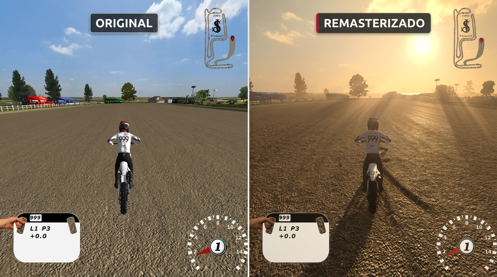
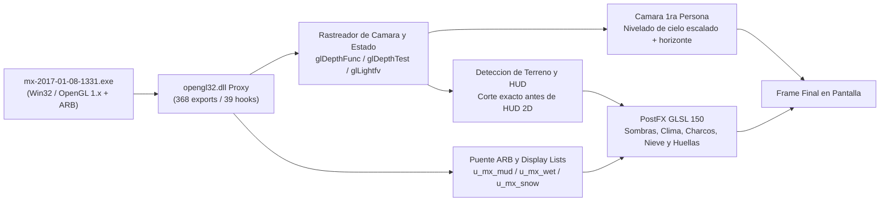

<div align="center">



<br />
<br />

-111827?style=for-the-badge&labelColor=e11d48)


<br />

<p>
  <a href="#comparativa-visual">Comparativa</a> &nbsp;&middot;&nbsp;
  <a href="#caracteristicas-principales">Caracteristicas</a> &nbsp;&middot;&nbsp;
  <a href="#arquitectura-del-proxy">Arquitectura</a> &nbsp;&middot;&nbsp;
  <a href="#adaptacion-para-snapshot-2017">Adaptacion 2017</a> &nbsp;&middot;&nbsp;
  <a href="#instalacion">Instalacion</a> &nbsp;&middot;&nbsp;
  <a href="#controles-en-juego">Controles</a> &nbsp;&middot;&nbsp;
  <a href="#integridad-y-firma">Integridad</a> &nbsp;&middot;&nbsp;
  <a href="#creditos-y-licencia">Creditos</a>
</p>

</div>

---

## Resumen

**MXS-Remastered-Rodri** es una adaptacion compilada en **32 bits (`Win32`)** del proyecto open-source [Voaks/MXS-Remastered](https://github.com/Voaks/MXS-Remastered), reconfigurada y corregida a nivel de llamadas OpenGL para funcionar de forma nativa sobre el ejecutable clasico **MX Simulator 2017 Snapshot (`mx-2017-01-08-1331.exe`)**.

El proyecto original esta pensado para versiones modernas de 64 bits con pipeline de shaders OpenGL 3.x+. Esta edicion incorpora un puente completo entre el motor antiguo de 2017 (OpenGL 1.x de funcion fija + `GL_ARB_shader_objects` + `Display Lists`) y el motor moderno de postprocesado `GLSL 150`, manteniendo el juego intacto y sin modificar ejecutables ni archivos `.saf`.

---

## Comparativa Visual

<div align="center">
  
  <br />
  <sub>Izquierda: MX Simulator 2017 sin modificar. Derecha: MXS-Remastered-Rodri con iluminacion direccional, hora del dia dinamica, detalle de tierra, sombras y huellas activas.</sub>
</div>

---

## Caracteristicas Principales

| Modulo | MX Simulator 2017 Original | MXS-Remastered-Rodri |
| :--- | :--- | :--- |
| **Iluminacion y Cielo** | Luz estatica fija de pista | Hora del dia dinamica (`00:00` a `24:00`), movimiento real del sol, rayos solares, bloom y ajuste de exposicion |
| **Sombras** | Sin shadow map dinamico | Shadow map `2048x2048` en tiempo real para moto, piloto y objetos, oclusion ambiental (AO) y sombra del torso en 1ra persona |
| **Clima Dinamico** | Sin clima en terreno | Lluvia con suelo mojado, charcos reflectantes y brillo en moto/piloto; nieve acumulada en suelo y cubiertas |
| **Terreno y Ruedas** | Superficie plana sin marcas persistentes | Detalle fino de tierra, huellas/roderas persistentes de ambas ruedas, barro/nieve sobre las cubiertas y `roost` dinamico |
| **Camara Primera Persona** | Camara rigida vinculada al juego | Estabilizacion de horizonte y cabeceo (`HorizonLock` / `PitchLock`), filtro de inercia, cuello dinamico y ocultado de torso propio |
| **Sonidos de Motor** | Tablas de audio stock de 2017 | 5 packs de sonido incluidos (`125 2T`, `250 2T`, `250F 4T`, `450F 4T` y `450F 4T Clear`) activables desde el menu |
| **HUD y Menus** | Render plano bajo `glFrustum` | Deteccion exacta previa al HUD (`GL_ALWAYS`), menus y pantallas de carga sin distorsion ni oscurecimiento |
| **Interfaz en Vivo** | Edicion manual de archivos | Menu superpuesto en juego con la tecla <kbd>E</kbd>, 5 presets intercambiables y guardado instantaneo |

---

## Arquitectura del Proxy

El archivo `opengl32.dll` actua como proxy transparente delante de la libreria del sistema (`SysWOW64\opengl32.dll`). Intercepta unicamente los puntos clave de la tuberia grafica de 2017 y delega las 368 exportaciones restantes sin perdida de rendimiento.



---

## Adaptacion para Snapshot 2017

El ejecutable de 2017 utiliza convenciones graficas distintas a las versiones modernas de MX Simulator. Para lograr estabilidad completa se implementaron y verificaron las siguientes correcciones:

<details>
<summary><strong>Ver desglose tecnico de las correcciones implementadas (clic para desplegar)</strong></summary>

<br />

1. **Compilacion nativa `Win32` (`x86`):** reemplazo del proxy x64 por stubs de salto indirecto de 32 bits (`368` exportaciones compatibles con `mx-2017-01-08-1331.exe`).
2. **Deteccion deterministica de terreno y HUD (`glDepthFunc`):** la snapshot 2017 dibuja terreno con `GL_ALWAYS`, cambia a `GL_LEQUAL` para la escena 3D y vuelve a `GL_ALWAYS` para el HUD manteniendo `glFrustum`. Al rastrear esas transiciones, el pase de terreno cierra en el punto exacto y el HUD nunca se oscurece ni se inclina.
3. **Proteccion de menus y pantallas de carga:** seguimiento de `GL_DEPTH_TEST`, `glLightfv` y shader activo para evitar que los menus de configuracion o pantallas de carga (`Loading decals.`) sean interpretados como camara 3D.
4. **Nivelado de cielo escalado (`glScalef`):** descomposicion uniforme de la matriz de rotacion del skybox (`2886.75x`) para eliminar cortes diagonales en el horizonte al activar `HorizonLock`.
5. **Precision `float32` en pistas de coordenadas grandes:** tolerancia relativa en `SameMat4` para evitar la perdida de la mascara de terreno (nieve, charcos y huellas) cuando la pista supera `2048` pies desde el origen.
6. **Compatibilidad con `GL_ARB_shader_objects` y `GL_EXT_framebuffer_object`:** aislamiento de pases FBO secundarios, respaldo/restauracion de programas ARB y `GL_DEPTH_FUNC` en `postfx`, y fallbacks ARB en el lote de sombras (`FlushShadowCasters`).
7. **Nieve y humedad en cubiertas 2017 (`GLSL 1.10`):** inyeccion segura de `u_mx_mud`, `u_mx_wet` y `u_mx_snow` sobre los shaders de moto/piloto originales de 2017.
8. **Rastreo de `Display Lists` y transicion 3ra a 1ra persona:** captura de geometria compilada para ruedas/sombras y reinicio inteligente de offsets al cambiar de pieza anclada sin perder la rueda trasera en motos personalizadas.
9. **Filtro de `skyring` exterior en deteccion de estadios:** evita que anillos de horizonte mayores a `600 m` desactiven sombras de arboles y lomas en pistas al aire libre.

</details>

---

## Instalacion

El repositorio contiene los binarios, la configuracion base y la carpeta de packs de sonido listos para copiar directo al juego.

### Contenido incluido

| Archivo / Carpeta | Funcion |
| :--- | :--- |
| `opengl32.dll` | Proxy OpenGL de 32 bits con motor de shaders, clima y camara en primera persona |
| `MXS_REMASTERED.ini` | Configuracion inicial lista para usar y editable en vivo desde el juego |
| `MXS_REMASTERED_patch_notes.txt` | Registro de cambios mostrado en el panel interno del mod |
| `MXS_REMASTERED_sounds/` | Packs de sonido de motor (`125 2T`, `250 2T`, `250F 4T`, `450F 4T` y `450F 4T Clear`) |
| `comparison.jpg` | Captura comparativa de referencia (`Original` vs `Remasterizado`) |
| `banner.svg` | Encabezado vectorial del repositorio |
| `LICENSE` | Licencia MIT con atribucion al proyecto base y a esta adaptacion |

<details>
<summary><strong>Ver packs de sonido incluidos en <code>MXS_REMASTERED_sounds/</code> (clic para desplegar)</strong></summary>

<br />

| Archivo `.pack` | Motor que reemplaza |
| :--- | :--- |
| `MXS_REMASTERED_engine_default125.pack` | `125` dos tiempos (`default125`) |
| `MXS_REMASTERED_engine_default250.pack` | `250` dos tiempos (`default250`) |
| `MXS_REMASTERED_engine_default250f.pack` | `250F` cuatro tiempos (`default250f`) |
| `MXS_REMASTERED_engine_default450f.pack` | `450F` cuatro tiempos (`default450f`) |
| `MXS_REMASTERED_engine_default450f_clear.pack` | `450F` cuatro tiempos limpio (`default450f`) |

</details>

### Pasos de instalacion

1. Cerra completamente **MX Simulator** si se encuentra en ejecucion.
2. Ubica la carpeta principal de instalacion del juego (la misma carpeta donde esta `mx-2017-01-08-1331.exe`).
3. Copia estos archivos y carpeta dentro de la carpeta del juego:
   - `opengl32.dll`
   - `MXS_REMASTERED.ini`
   - `MXS_REMASTERED_patch_notes.txt`
   - `MXS_REMASTERED_sounds/` (carpeta completa)
4. Inicia el juego normalmente desde `mx-2017-01-08-1331.exe`.
5. Una vez en pista, presiona <kbd>E</kbd> para abrir el panel de **MXS Remastered**:
   - Activa o ajusta graficos en la pestana **GRAPHICS**.
   - Activa lluvia o nieve en la pestana **WEATHER**.
   - Activa la camara dinamica en **FIRST PERSON** (o directamente con <kbd>F8</kbd>).
   - Activa los packs de sonido de motor en la pestana **SOUNDS** (el mod instala automaticamente el `.saf` correspondiente al reiniciar el juego).
   - Presiona **SAVE** dentro del menu para conservar tus cambios.

> **Recomendacion de calibracion (una sola vez):** al iniciar en pista, circula unos 5 segundos en linea recta en tercera persona para que el mod aprenda la posicion exacta de ambas ruedas y la guarde automaticamente en `MXS_REMASTERED.ini`. A partir de ese momento, las huellas y sombras funcionaran al instante tambien en primera persona.

### Desinstalacion

Para volver al juego completamente original, basta con eliminar `opengl32.dll`, la carpeta `MXS_REMASTERED_sounds/` y los archivos `MXS_REMASTERED.*` de la carpeta de MX Simulator. Ningun archivo original del juego es modificado.

---

## Controles en Juego

| Tecla | Accion |
| :--- | :--- |
| <kbd>E</kbd> | Abrir o cerrar el menu de configuracion en tiempo real |
| <kbd>F7</kbd> | Activar o desactivar shaders en vivo (comparacion instantanea) |
| <kbd>F8</kbd> | Activar o desactivar el mod de camara en primera persona |
| <kbd>F9</kbd> | Recargar `MXS_REMASTERED.ini` sin reiniciar el juego |
| <kbd>F10</kbd> | Volcar diagnostico de un frame en `MXS_REMASTERED.log` |
| <kbd>F11</kbd> | Grabar traza de telemetria de camara (`MXS_REMASTERED_trace.csv`) |

---

## Resolucion de Problemas

<details>
<summary><strong>Preguntas frecuentes y diagnostico rapido (clic para desplegar)</strong></summary>

<br />

- **El juego no abre o no muestra el menu con `E`:** verifica que `opengl32.dll` este en la misma carpeta que `mx-2017-01-08-1331.exe` y que estes usando el ejecutable de 32 bits (`x86`). Al iniciar debe generarse `MXS_REMASTERED.log` en esa misma carpeta.
- **Al cambiar a lluvia o nieve no se ve el efecto:** entra al menu con <kbd>E</kbd> -> `GRAPHICS` -> confirma que `Shaders` este activado, y luego en `WEATHER` selecciona `RAIN` o `SNOW`.
- **Quiero restablecer la calibracion de la moto:** cierra el juego, borra la seccion `[Learned]` dentro de `MXS_REMASTERED.ini` y vuelve a rodar 5 segundos en tercera persona.
- **Errores de escritura en `Program Files`:** si el juego esta instalado en una carpeta protegida por Windows, el mod guarda automaticamente configuracion y logs en tu carpeta de usuario.

</details>

---

## Integridad y Firma

Cada compilacion distribuida en este repositorio incluye su huella criptografica para verificar que el binario `opengl32.dll` no fue alterado:

```powershell
Get-FileHash -Algorithm SHA256 .\opengl32.dll
```

| Archivo | Arquitectura | SHA-256 |
| :--- | :--- | :--- |
| `opengl32.dll` | `Win32 (x86)` | `85A266EF3F76475FD87351EAE46A896BE4DAC9EFC72F4EA9DD81198856020D3D` |

---

## Creditos y Licencia

- **Proyecto base original:** [Voaks/MXS-Remastered](https://github.com/Voaks/MXS-Remastered) por **Voaks**, distribuido bajo [Licencia MIT](./LICENSE).
- **Portabilidad 32-bit, ingenieria de compatibilidad Snapshot 2017, correcciones y empaquetado:** adaptado y firmado por **[Rodri (RodriA45)](https://github.com/RodriA45)**.

<div align="right">
  <sub>MXS-Remastered-Rodri &mdash; Adaptado y firmado por <a href="https://github.com/RodriA45"><strong>RodriA45</strong></a></sub>
</div>
